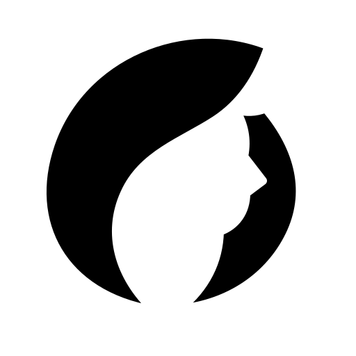

<p align="center">
  
</p>

<h1 align="center">Caress <small>/kəˈres/</small></h1>

刮削 JAV 视频元数据。

- 多源刮削：支持 DMM、JavDB、JavBus 等来源；
- 配套插件：Emby 插件直接读取本地 NFO、封面、剧照和演员头像；
- 演员头像：从 gfriends 获取，按日文主名、中文名和别名匹配；
- 封面裁剪：检测人脸，自动裁剪为适用于 Emby 的 2:3 封面；
- 自动翻译：配置 OpenAI 兼容 API 后，自动翻译作品标题与剧情；
- 标准格式：使用符合 Emby 规范的 NFO，图片独立保存。

## 部署

下载源码，或通过 Git 克隆后进入项目目录：

```sh
git clone --depth=1 https://github.com/qvshuo/Caress.git caress && cd caress
mkdir -p data
cp docker-compose.example.yml docker-compose.yml

# 修改 docker-compose.yml 中的作品目录和数据目录后启动
docker compose up -d --build
```

打开 `http://服务器IP:9307`。

**补齐缺失**按当前路由更新自动字段和图片，保留手动编辑、指定来源与自定义空值；**重新刮削**替换所有字段和图片。**更新头像**重新获取所选演员头像，不改 NFO，失败保留旧图。

作品分类优先查询本地番号规则，未命中时采用来源分类；缺少依据时保留未分类。

来源按请求域名分别冷却，API 与网页使用不同域名时互不影响；请求间隔仍按来源共享。来源设置可统一解除该来源所有域名的冷却。

## 使用

1. 设置作品目录和元数据目录，视频或 STRM 文件的父文件夹名称须为完整番号，且不能重复；
2. 配置 OpenAI 兼容 API，用于翻译；
3. 下载 [caress.dll](emby-plugin/caress.dll?raw=true)，放入 Emby 配置目录下的 `plugins` 文件夹，Docker 部署时，对应 Emby 容器内的 `/config/plugins`；

4. 在 Emby 的 Compose 服务中挂载元数据目录，冒号左侧填写 Caress 元数据目录在宿主机上的绝对路径：

   ```yaml
   volumes:
     - /path/to/data/metadata:/caress-metadata:ro
   ```

5. 在 Emby 的 Compose 文件所在目录执行以下命令，应用挂载并加载插件：

   ```sh
   docker compose down && docker compose up -d
   ```

6. 在媒体库的元数据读取器中启用 **Caress**，随后刷新媒体库。

插件直接读取本地文件，无需连接 Caress 服务。运行期间会监听元数据目录的变更并自动刷新媒体库；首次接入时仍需手动刷新媒体库。

插件设置页只配置元数据目录，设置保存在 Emby 配置目录的 `plugins/configurations/Caress.json`，Docker 中通常为 `/config/plugins/configurations/Caress.json`。
